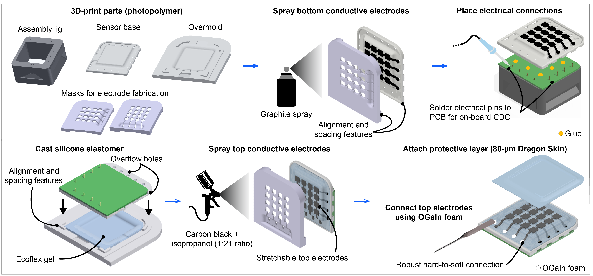

# Learning-enhanced soft capacitive arrays with cross-sensor generalization for tactile robotics


<p align="center">
  <a href="LINK_TO_PAPER">📄 Paper</a> |
  <a href="LINK_TO_VIDEO">🎥 Demo</a> |
  <a href="LINK_TO_APPLICATION_VIDEO">🤖 Applications</a> |
</p>

## Overview

Tactile sensing is essential for robotic manipulation, but achieving reliable, accurate, and reproducible sensing in real systems remains challenging. This work addresses key challenges in reproducibility, system integration, and calibration-free deployment, which have limited the practical use of tactile sensing in robotics.

Our approach combines soft capacitive sensor arrays, co-located low-noise electronics, and lightweight machine learning into a single pipeline for real-time estimation of contact location and force. The sensors are fabricated using accessible and repeatable methods, enabling consistent behavior across independently fabricated copies, while the integrated electronics provide stable, low-noise measurements.

We use compact neural networks to achieve super-resolution tactile sensing, enabling fine-grained estimation of contact location and continuous pressure distributions from a coarse sensor array .

A central aspect of this work is enabling consistent performance without sensor-specific calibration. We adopt a transfer learning approach in which models trained across multiple sensor instances generalize to new, unseen sensors, allowing deployment without additional data collection or retraining .

We validate the complete system in real-time robotic tasks, demonstrating closed-loop control driven directly by tactile feedback.

This work makes four key contributions: first, we introduce a reproducible soft capacitive sensing architecture with integrated electronics for stable, low-noise measurements; second, we develop lightweight neural network models that enable accurate force estimation and super-resolution tactile sensing; third, we demonstrate transfer of learned models across independently fabricated sensors without recalibration; and fourth, we validate our approach in real-time robotic interaction.

## Real time robotics applications 
The videos below show the tactile sensor operating in real time, demonstrating contact localization and normal force estimation across the entire surface.

## Fabrication
The sensor arrays are fabricated using 3D-printed molds and masks, with graphite-sprayed bottom electrodes, a silicone elastomer (Ecoflex Gel) dielectric layer, and airbrushed carbon-based stretchable top electrodes. Electrical connections are formed using OGaIn foam to ensure robust soft–rigid interfacing, and the sensor is encapsulated with a thin protective elastomer layer. All design and fabrication files are provided [here](Fabrication/CAD%20files/).



## Project Structure
- **Fabrication/**: Fabrication files to reproduce our tactile sensors.
- **Code/Sensor Code/**: Arduino C++ firmware for reading the 4x4 sensor array.
- **Code/Sensor Characterization/**: MATLAB scripts for sensor performance analysis.
- **Code/Machine learning modelling/**: Python implementation of single point contact estimation and force map estimation machine learning (ML) models.
- **Code/LOGO-CV/**: Implementation scripts for training and validating ML models to ensure their transferability across new physical sensor copies.

## Installation & Setup

### 1. Requirements
Install the necessary Python libraries using the provided `requirements.txt` file:
```bash
pip install -r requirements.txt
```
- **MATLAB**: Required for characterization scripts.
- **Arduino IDE**: Required for hardware firmware.

### 2. Important: Data Folder Placement
The `Data/` folder (datasets, results, and trained models) must be downloaded separately from [Edmond Data Repository](https://doi.org/your-data-doi) and placed in your project root for the relative paths in the code to work.  

**Correct Directory Structure:**
```text
[Project Root]/
├── Code/ (The folders from this repository)
└── Data/ (The downloaded Datasets, Results, and Trained Models)
```

## Citation

## License
